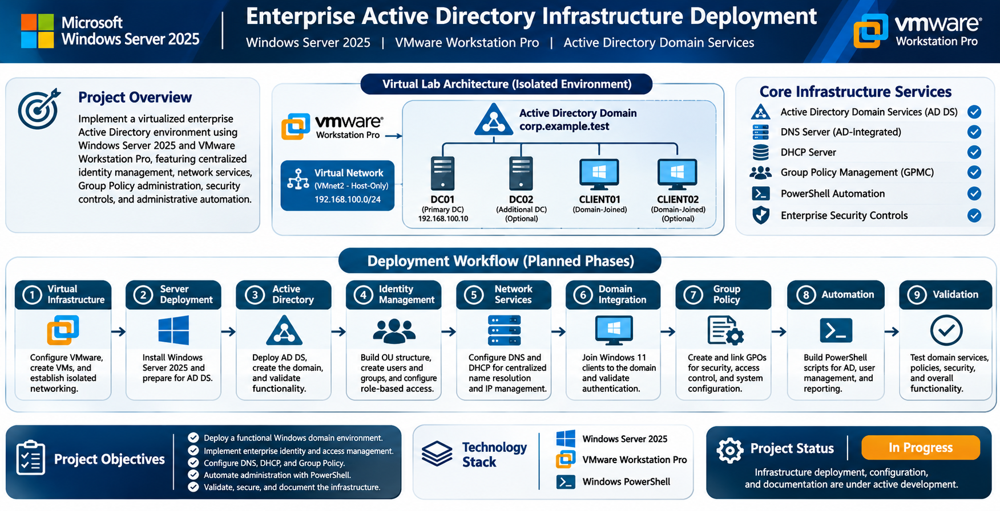

<div align="center">


# Enterprise Active Directory Infrastructure Deployment

**Windows Server 2025 | VMware Workstation Pro | Active Directory Domain Services**


</div>

---

## Project Overview

This project documents the implementation of a virtualized enterprise Active Directory environment using **Windows Server 2025** and **VMware Workstation Pro**.

The infrastructure is designed to simulate a corporate Windows domain environment with centralized identity management, domain authentication, organizational unit architecture, role-based access control, network services, and Group Policy administration.

The deployment will follow structured infrastructure engineering practices, including system configuration, security controls, administrative automation, technical validation, and troubleshooting documentation.

All infrastructure is hosted locally within an isolated VMware virtual network.

<p align="center">
  
</p>

<p align="center">
  <em>High-level overview of the virtualized Active Directory infrastructure, planned architecture, and deployment workflow.</em>
</p>

> **Project Status:** In Progress  
> This repository is under active development. Technical documentation, PowerShell scripts, configuration evidence, and validation results will be added as deployment milestones are completed.

---

## Technology Stack

| Technology | Implementation |
|---|---|
| Virtualization | VMware Workstation Pro |
| Server OS | Windows Server 2025 |
| Client OS | Windows 11 Enterprise |
| Directory Services | Active Directory Domain Services (AD DS) |
| Domain Authentication | Kerberos / NTLM |
| Name Resolution | Windows DNS Server |
| IP Address Management | Windows DHCP Server |
| Policy Management | Group Policy Management Console (GPMC) |
| Identity Management | Active Directory Users and Computers (ADUC) |
| Access Control | Security Groups / RBAC / NTFS |
| Automation | Windows PowerShell |
| Troubleshooting | Event Viewer / DCDIAG / NLTEST / GPRESULT |

---

## Planned Infrastructure Architecture

The environment will consist of a Windows Server domain controller and domain-joined Windows client systems operating within an isolated VMware virtual network.

### Virtual Machine Inventory

| Hostname | Operating System | Assigned Role |
|---|---|---|
| DC01 | Windows Server 2025 | Primary Domain Controller, AD DS, DNS |
| CLIENT01 | Windows 11 Enterprise | Domain-Joined Workstation |
| DC02 | Windows Server 2025 | Additional Domain Controller (Optional) |
| CLIENT02 | Windows 11 Enterprise | Additional Domain Workstation (Optional) |

### Proposed Network Configuration

| Configuration | Planned Value |
|---|---|
| Virtual Network | VMware VMnet2 |
| Network Type | Host-Only |
| Network Address | 192.168.100.0/24 |
| Domain Controller IP | 192.168.100.10 |
| Client Addressing | Static / DHCP |
| DNS Server | 192.168.100.10 |
| Active Directory Domain | corp.example.test |
| DHCP Scope | 192.168.100.100–192.168.100.199 |

The virtual environment will be isolated from the physical production network to support controlled infrastructure deployment, configuration testing, and troubleshooting.

---

## Project Scope

### 1. VMware Virtual Infrastructure

- Configure VMware Workstation Pro.
- Create and configure virtual machines.
- Allocate CPU, memory, and virtual storage resources.
- Establish isolated virtual networking using VMware VMnet2.
- Configure virtual network adapters and connectivity.
- Establish VM snapshot checkpoints.

### 2. Windows Server Deployment

- Install Windows Server 2025.
- Configure server hostname and static IP addressing.
- Configure network settings and DNS.
- Install Active Directory Domain Services.
- Promote DC01 to a domain controller.
- Establish the Active Directory forest and domain.
- Validate domain controller functionality.

### 3. Active Directory Administration

- Design organizational unit hierarchy.
- Create departmental organizational units.
- Provision domain user accounts.
- Create and manage security groups.
- Configure role-based group membership.
- Implement administrative delegation.
- Organize domain computer accounts.

### 4. DNS and DHCP Infrastructure

- Configure Active Directory-integrated DNS.
- Validate forward and reverse name resolution.
- Configure DHCP server roles and scopes.
- Configure DHCP lease parameters.
- Configure DNS and DHCP options.
- Validate client network configuration.

### 5. Domain Workstation Integration

- Deploy Windows 11 Enterprise virtual workstations.
- Configure client DNS and networking.
- Join client systems to the Active Directory domain.
- Validate domain user authentication.
- Verify workstation domain membership.
- Test domain connectivity and name resolution.

### 6. Group Policy Administration

- Create and link Group Policy Objects.
- Configure domain password policies.
- Configure account lockout policies.
- Deploy workstation security restrictions.
- Configure Windows Defender Firewall policies.
- Configure security auditing.
- Validate Group Policy application.

### 7. PowerShell Automation

- Automate organizational unit creation.
- Automate domain user provisioning.
- Automate security group creation.
- Configure group memberships programmatically.
- Develop employee onboarding procedures.
- Develop account disabling and offboarding procedures.
- Generate Active Directory administrative reports.

### 8. Infrastructure Validation

- Validate Active Directory domain services.
- Test DNS resolution and DHCP assignment.
- Verify domain controller health.
- Test Kerberos domain authentication.
- Validate Group Policy processing.
- Verify access permissions.
- Investigate Windows Event Viewer logs.
- Document troubleshooting and remediation.

---

## Deployment Progress

The following milestones will be updated as each implementation phase is completed and validated.

- [ ] Phase 01 — VMware Workstation Pro Configuration
- [ ] Phase 02 — Windows Server 2025 Installation
- [ ] Phase 03 — Active Directory Domain Services Deployment
- [ ] Phase 04 — Organizational Unit Architecture
- [ ] Phase 05 — User and Security Group Management
- [ ] Phase 06 — Windows 11 Domain Integration
- [ ] Phase 07 — Group Policy Configuration
- [ ] Phase 08 — DNS and DHCP Configuration
- [ ] Phase 09 — PowerShell Administrative Automation
- [ ] Phase 10 — Security Hardening
- [ ] Phase 11 — Infrastructure Testing and Validation
- [ ] Phase 12 — Technical Documentation and Evidence

---

## Engineering Documentation

As the deployment progresses, this repository will include detailed technical documentation covering:

- Infrastructure design and configuration decisions.
- Step-by-step deployment procedures.
- Windows Server administration commands.
- Active Directory configuration procedures.
- PowerShell scripts and automation.
- Group Policy implementation.
- Security configurations.
- System troubleshooting and diagnostics.
- Configuration screenshots and validation evidence.

Documentation will distinguish between planned infrastructure, completed configurations, and successfully validated functionality.

---

## Repository Structure

The repository will be organized as follows as project deliverables are completed.

```text
Enterprise-Active-Directory-Infrastructure-Deployment/
|
|-- README.md
|
|-- assets/
|   |-- brandons-logo.png
|   `-- flowchart.png
|
|-- architecture/
|   |-- network-topology.png
|   `-- infrastructure-design.md
|
|-- documentation/
|   |-- 01-vmware-deployment.md
|   |-- 02-windows-server.md
|   |-- 03-active-directory.md
|   |-- 04-identity-management.md
|   |-- 05-domain-integration.md
|   |-- 06-group-policy.md
|   |-- 07-dns-dhcp.md
|   `-- 08-validation.md
|
|-- scripts/
|   |-- active-directory/
|   |-- user-management/
|   `-- reporting/
|
`-- evidence/
    |-- vmware/
    |-- server/
    |-- active-directory/
    |-- group-policy/
    |-- networking/
    `-- validation/
```

---

## Security Considerations

The project will follow security-conscious infrastructure administration practices, including:

- Isolated virtual network architecture.
- Principle of least privilege.
- Role-based access control.
- Administrative account separation.
- Group Policy security enforcement.
- Domain account lifecycle management.
- Windows security event auditing.
- Controlled administrative permissions.

All accounts, hostnames, and organizational information used in the environment will be fictional and created exclusively for laboratory testing.

No production credentials, private keys, or sensitive infrastructure information will be published.

---

## Project Status

**In Progress — Infrastructure Deployment**

This project is being developed as a practical demonstration of Windows Server administration, Active Directory infrastructure deployment, identity and access management, enterprise networking, security administration, and PowerShell automation.

Implementation evidence and technical findings will be published as each phase is completed.

---

<div align="center">

**Brandon Stevenson**

*IT Infrastructure | Systems Administration | Network Engineering*

</div>
